# AIperture Labs

A small graphics R&D lab: real-time rendering, Vulkan and modern C++.
Mostly one human and a lot of validation layers.

### 🔭 Projects

- **[AetherEngine](https://github.com/AIperture-Labs/AetherEngine)**: a lightweight, modular game engine built on Vulkan. Freshly restarted, big plans (previous code base: [AetherEngine-legacy](https://github.com/AIperture-Labs/AetherEngine-legacy)).
- **[project-aether](https://github.com/AIperture-Labs/project-aether)**: notes, code examples and best practices from learning Vulkan the hard way.
- **[tutorial-how-to-vulkan](https://github.com/AIperture-Labs/tutorial-how-to-vulkan)**: working through Sascha Willems' *How to Vulkan*, one triangle at a time.

### 🗺️ Roadmap

Generated daily from the repositories' milestones · [global plan](https://github.com/AIperture-Labs/.github/blob/main/PLAN.md)

### 🧰 Toolbox

C++23 · Vulkan · CMake · just · RenderDoc · Tracy

Run by [@XavierBeheydt](https://github.com/XavierBeheydt) · Forks of dependencies (glm, doctest, yasm, libjpeg-turbo) live here for the engine build.
